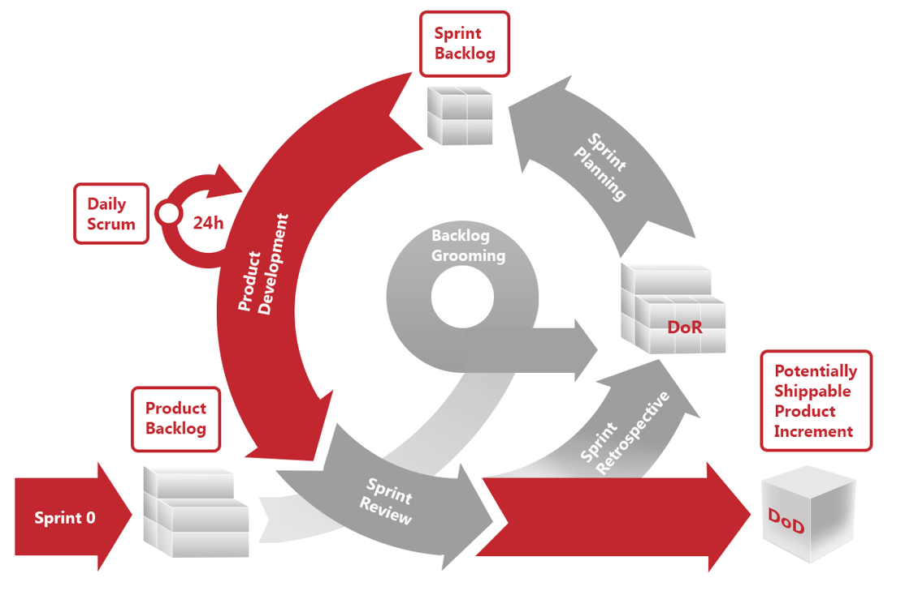
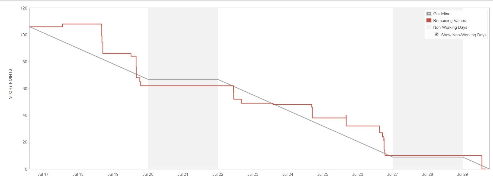
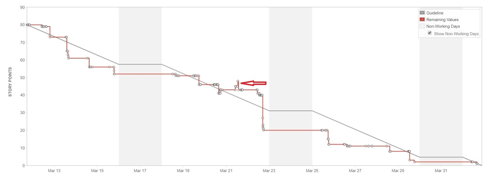

# Scrum теория

## Оглавление

- [Манифест](#манифест)
- [Scrum](#scrum)
- [Роли](#роли)
- [Спринты](#спринты)
- [Артефакты](#артефакты)
- [События](#события)
- [Оценки](#оценки)

---

## Манифест

Scrum сам по себе является лишь одним из фреймворков Agile и базируется на основных постулатах, закрепленных в Agile манифесте. Этих постулатов всего 4, но они очень полезны, так как сам Scrum говорит нам только об обязательных к использованию вещах, которых не так уж и много, а все остальное мы должны решать сами, исходя из текущей ситуации и потребностей.

Главный вопрос: как принять какое-то решение и при этом убедиться в том, что оно не порушит сам Scrum Framework? Ответ очень прост: нужно проверить его на соответствие манифесту, и если он ему противоречит, то ваш Scrum пострадает и не сможет приносить пользу.

Итак - 4 основных постулата манифеста:

- Люди и взаимодействие важнее процессов и инструментов

- Работающий продукт важнее исчерпывающей документации

- Сотрудничество с заказчиком важнее согласования условий контракта

- Готовность к изменениям важнее следования первоначальному плану.

Также манифест содержит 12 принципов, которые тоже полезно знать:

- Наивысшим приоритетом для нас является удовлетворение потребностей заказчика благодаря регулярной и ранней поставке ценного программного обеспечения.

- Изменение требований приветствуется даже на поздних стадиях разработки. Agile-процессы позволяют использовать изменения для обеспечения заказчику конкурентного преимущества.

- Работающий продукт следует выпускать как можно чаще, с периодичностью от пары недель до пары месяцев.

- На протяжении всего проекта разработчики и представители бизнеса должны ежедневно работать вместе.

- Над проектом должны работать мотивированные профессионалы. Чтобы работа была сделана, создайте условия, обеспечьте поддержку и полностью доверьтесь им.

- Непосредственное общение является наиболее практичным и эффективным способом обмена информацией как с самой командой, так и внутри команды.

- Работающий продукт — основной показатель прогресса.

- Инвесторы, разработчики и пользователи должны иметь возможность поддерживать постоянный ритм бесконечно. Agile помогает наладить такой устойчивый процесс разработки.

- Постоянное внимание к техническому совершенству и качеству проектирования повышает гибкость проекта.

- Простота — искусство минимизации лишней работы — крайне необходима.

- Самые лучшие требования, архитектурные и технические решения рождаются у самоорганизующихся команд.

- Команда должна систематически анализировать возможные способы улучшения эффективности и, соответственно, корректировать стиль своей работы.

## Scrum

Итак, мы разобрались с постулатами и принципами и плавно подошли к самому Scrum.

Весь фрейморк, в том виде, в котором его используем мы, можно вместить в одну картинку:

Но обо всем по порядку.

### Роли

К стандартным ролям в Scrum относятся:

#### Product Owner – это всегда один человек, который имеет право принимать решения, касающиеся объёма работ.

В его обязанности входит:

- коммуникация с командой

- сбор требований

- формирование Backlog и его приоритизация

- приемка результатов спринта.

Не путайте Product Owner с заказчиком, это не всегда так. Это может быть отдельно нанятый специалист, который даже не состоит в штате заказчика, или даже сотрудник Oxagile, который был нанят для выполнения этой работы. В проектах, на которых работает Бизнес Аналитик, и именно он чаще всего обсуждает требования с заказчиком, можно расценивать именно его как Product Owner.

#### Scrum Master – это не Project Manager, очень важно это понимать. Да, он может параллельно выполнять менеджерские задачи, но его основными задачами является:

- следить за строгим соблюдением Scrum Framework командой разработки и Product Owner

- коучить команду, помогая ей устранять факторы, которые препятствуют работе над проектом

- инициировать события Scrum.

ЗАПОМНИТЕ - отвечает за проект именно команда, и как только в ней появляется человек, который решает все и за всех, это уже не Scrum, и вероятность успеха такого проекта сомнительна.

#### Development Team – это собственно команда специалистов, которые работают над проектом.

Они должны:

- предоставлять оценки

- давать комит на инкремент, разрабатываемый в рамках спринта

- строго следовать Scrum Framework.

### Дополнительные роли, используемые в Oxagile

#### Delivery Manager – это человек, который следит за ходом выполнения проекта без активного в него вмешательства. Он собирает статистику, контролирует ключевые показатели на проекте, дает экспертное заключение и советы по спорным моментам и потенциальным улучшениям, помогает команде в сложных ситуациях.

#### Account Manager – это человек, который следит за контрактом и его исполнением, помогает поддерживать хорошие отношения с заказчиком, решать сложные конфликты, а также собирает дополнительные отзывы от заказчика, чтобы понять, насколько он удовлетворен ходом реализации проекта и командой.

### Спринты

Спринтом в Scrum считается определенный промежуток времени длинной от 2х до 4х недель, в течение которого команда реализует часть функционала проекта, включая разработку, тестирование и доставку, в случае если она запланирована или на проекте применяется continuous delivery. В спринт также могут входить другие задачи, которые необходимо выполнить для успешной реализации проекта. Ярким примером может быть изучение новой технологии, которую необходимо применить на проекте.

Основные требования к Спринту:

- должен всегда иметь одинаковую длительность. Длительность выбирается вначале проекта

- должен иметь определенную цель, актуальную для Product Owner.

Внимание: спринт не может быть остановлен никем, кроме Development Team и Product Owner. При этом для его остановки есть только по одному основанию у каждой из ролей.

Development Team может остановить спринт только при наличии одного основания – невозможно выполнить запланированные работы ввиду технических, раннее не известных ограничений.

Product Owner  может остановить спринт только при наличии одного основания – цель спринта утратила значение для его бизнеса.

Все остальные основания не являются поводом для остановки спринта.

### Артефакты

К основным артефактам Scrum относятся:

- Backlog

- Overall Project Progress Tracking

- Sprint Backlog

- Sprint Progress Tracking

- Increment

#### Backlog – это собственно список задач, которые необходимо выполнить. Его формирует и за него отвечает Product Owner.

Основными требованиями к Backlog являются:

- должен быть понятен Development Team и Product Owner

- должен быть приоритизирован

- должен быть оценен в Story Points (о них чуть ниже).

#### Overall Project Progress Tracking – это любой удобный инструмент для контроля прогресса проекта. Это может быть соотношение количества выполненных задач к задачам, которые еще нужно выполнить, либо такое же соотношение оценок задач в Story Points. Очень часто используется показатель под названием Velocity. Посчитать его достаточно просто. Необходимо количество затраченных часов поделить на количество Story Points, которое за это время было сделано.

Пример:

14 часов / 10 Story Points = 1.4.

Это и есть наша Velocity. Она может меняться от спринта к спринту, и каждый раз мы высчитываем среднюю. Этот показатель очень важен для того, чтобы понимать, сколько времени нам нужно, чтобы закончить весь Backlog, известный на текущий момент.

Пример:

Допустим, наша средняя Velocity 1.4 и нам нужно узнать сколько рабочих часов нам нужно, чтобы полностью сделать Backlog в 100 Story Points.

100 х 1.4 = 140 часов.

#### Sprint Backlog – это список задач, которые необходимо выполнить в рамках спринта. Требования к нему такие же, как и к Backlog

#### Sprint Progress Tracking – это любой удобный инструмент для контроля прогресса спринта. Самым распространённым является Вurndown Chart, этот инструмент наглядно рисует линию, по которой в идеальной ситуации должны сгорать Story Points в результате их выполнения, и рядом с ней показывает такую же линию, которая отображает реальный прогресс команды.

Если линия реального прогресса команды находится где-то рядом с идеальной линией, у вас все хорошо. Если линия реального прогресса команды сильно выше идеальной линии, это значит, что команда не справляется, и объем спринта слишком большой. Если же линия реального прогресса команды ниже идеальной, то это означает, что команда работает быстрее, чем планировалось, и не плохо было бы что-то еще докинуть в спринт.

Рассмотрим несколько примеров.

Хороший спринт выглядит примерно так:

Тут мы видим, что первое время разработчики кодили, потом пошло тестирование, и Story начали закрываться, график пошел вниз и после этого примерно находился недалеко от идеальной линии. Все хорошо.

Спринт, с которым не справляется команда, выглядит примерно так:

Тут очень хорошо видно, что прошло полспринта, и ничего не сдвинулось с места, потом был сокращен объем работ, и стало чуть лучше, но команда все равно не справилась, так как сокращение объёма было предпринято слишком поздно.

Спринт со слишком маленьким объемом работ выглядит примерно так:

На этом графике наглядно видно, что команда намного быстрее справлялась с объемом работ, в середине есть линия, которая резко подпрыгивает вверх и показывает нам, что объем был увеличен. Но, если посмотреть на линию далее, то видно, что это увеличение было слишком маленьким, чтобы полностью загрузить команду работой.

#### Increment – это определенный кусок выполненной работы в рамках спринта примерно равный предыдущим и готовый к использованию.

Требования к Increment:

Основное требование к Increment - это то, что он должен быть готов к использованию. Например, мы отдаем заказчику Sign In. В требованиях написано, что пользователь должен войти в систему по логину и паролю, а также через Google аккаунт. Если мы отдаем заказчику оба пункта из требований, но пользователь не может войти в систему, то это уже не Increment, даже если пользователь может что-то написать в полях ввода. Если же мы отдаем только вход в систему по логину и паролю, а входа через Google аккаунт нет, но при этом пользователь может ввести данные, нажать на кнопку и попасть в систему, то это уже можно назвать Increment, несмотря на то, что не все требования выполнены. Второй пункт может быть выполнен позже, но первый полноценно работает.

### Дополнительные артефакты, используемые Oxagile

#### Definition of Ready – определяет набор требований, после выполнения которых Story считается готовой к разработке.

Этот пункт будет освещен более подробно в других материалах.

#### Definition of Done – определяет набор требований, после выполнения которых Story считается выполненной.

Этот пункт будет освещен более подробно в других материалах.

#### Definition of Done vs Shippable – определяет набор дополнительных к Definition of Done требований, после выполнения которых Story готова к поставке.

Этот пункт будет освещен более подробно в других материалах.

#### Extended Burn Down chart -  по сути это тот же Overall Project Progress Tracking, только автоматизированный силами Oxagile, который помогает отслеживать прогресс проекта не только по основному Backlog, но и по отдельным релизам.

Выглядит он так:

По этому графику можно увидеть увеличение либо уменьшение объема работ, и так же предположение, когда может быть выполнен проект с определенной долей вероятности в процентах.

Посмотрим на синий столбец слева, под которым стоит цифра 0. Она показывает изначальный объём работ, который был определен, а во время спринта 0, который как раз и предназначен для сбора требований. Горизонтальная линия дана как ориентир.

Далее мы видим, что объем начинает расти и столбики уходят вниз, по их нижней части идет линия, которая показывает примерную тенденцию роста объема работ.

В то же время мы работаем и закрываем Story, поэтому верхняя часть столбиков тоже стремится вниз. Линия, которая их соединяет, показывает тенденцию выполнения объема работ.

На пересечении этих линий мы видим точку, которая говорит нам, что мы сможем выполнить всю работу, которая есть на текущий момент в спринте 11 при условии, что объем работ не будет больше расти.

Верхний конец зеленой линии показывает нам номер спринта, в котором мы завершим проект при условии, что будем работать в том же темпе, а объем работ сохранит текущую тенденцию роста.

### События

Для того чтобы понятно описать основные события, воспользуемся всем известным научным подходом, который ученики применяют в школе на уроках математики при решении задач.

Все помнят, что любое решение в школе начиналось с постановки цели и описания задач, которые необходимо выполнить чтобы достичь этой цели.

Основные события Scrum:

#### Sprint Planning

Цель:

- сформировать Backlog спринта.

Задачи:

- собраться вместе (Development team, Product Owner, Scrum master)

- посмотреть задачи в Backlog с наивысшим приоритетом

- задать уточняющие вопросы

- при необходимости сгруппировать или разбить Story, переоценить и добавить технические задачи, без которых реализация некоторых задач не возможна

- выбрать те, которые команда готова сделать в рамках спринта

- получить подтверждение от команды, что они готовы это выполнить в рамках спринта.

Время:

Первый день спринта, продолжительность 2 часа.

#### Daily Scrum

Цель:

- получить последнюю информацию по статусу задач и статусу спринта.

Задачи:

- озвучить, чем каждый занимался за последний день

- озвучить планы каждого на текущий день

- озвучить проблемы, которые мешают выполнению задач

- если проблемы можно решить быстро в рамках Daily Scrum, то сделать это, если нет, то назначить время, когда этот вопрос будет обсуждаться, и определить круг лиц, которые в этом будут участвовать.

На этом событии говорят только Scrum Master и Development Team, Product Owner присутствует, но должен молчать и слушать.

Время

Каждый день, продолжительность 15 минут.

#### Refinement

Цель

- привести Backlog в порядок.

Задачи:

- выставить приоритеты так, чтобы объема приоритизированных задач хватало хотя бы на 3 спринта вперед

- уточнить некоторые требования

- добавить и приоритизировать недостающие или новые задачи

- разбить или сгруппировать Story так, чтобы с ними было удобно работать

- оценить новые или переоценить старые Story, если это необходимо.

Время

2 раза за спринт, продолжительность каждой сессии 2 часа.

#### Sprint Review

Цель:

- продемонстрировать Increment созданный в рамках спринта. Хотя этот пункт можно отнести и к задачам, потому как у данного события есть еще одна долгосрочная и очень важная цель. Этой целью является пошаговое сближение видения проекта заказчиком и командой разработки.

Задачи:

- продемонстрировать Increment. Делать это нужно подробно показывая все позитивные и негативные сценарии

- получить от заказчика фидбек на каждую Story, которая вошла в Increment

- записать все замечания и закинуть их в Backlog

- записать новые идеи и так же закинуть их в Backlog.

Время

Последний день спринта, продолжительность 1-2 часа.

#### Sprint Retrospective

Цель:

- основной целью ретроспективы является улучшение процесса работы над проектом. Все вопросы, которые на нее выносятся, должны соответствовать этой цели.

ВАЖНО, на ретроспективе не присутствует ни заказчик, ни Product Owner. Это событие только для Development Team, и никто другой не должен им мешать решать свои вопросы.

Задачи:

- каждый должен подумать и подготовится к встрече

- каждый должен озвучить по несколько пунктов, которые он считает важными и которые на его взгляд положительно влияют на работу над проектом, а также пункты, которые необходимо исправить. Количество пунктов выбирает Scrum Master

- во время того, как люди озвучивают свои пункты, они не обсуждаются, только записываются

- после того, как все пункты задокуметированы, каждый из пунктов обсуждается. Схожие пункты необходимо сгруппировать

- во время обсуждения команда должна прийти к решению по каждому пункту. С решением должны согласиться все члены команды

- назначить ответственных за выполнение выработанных решений и сроки выполнения.

Время

Последний день спринта, продолжительность 2-3 часа

### Дополнительные события, которые используются в Oxagile

#### Sprint Planning Part 2

Цель:

- определить архитектурный подход и перепроверить достаточно ли работы у каждого из членов команды.

Задачи:

- обсудить способы имплементации каждой Story

- разбить Story на сабтаски и оценить их в часах.

Время

Сразу после Sprint Planning, продолжительность 2 часа.

#### Status Сheck with PO

Это событие относится к обязанностям Scrum Master.

Цель:

- донести обновления статуса проекта.

Задачи:

- обсудить текущие вопросы

- обсудить статус выполнения задач.

Время

Ежедневно, продолжительность 15 минут.

### Оценки

Оценки в Scrum, на первый взгляд, вещь простая, но на практике вызывает очень много вопросов.

Давайте рассмотрим пример.

У нас есть 2 бегуна марафонца. Один троекратный олимпийский чемпион, второй просто любитель с большим опытом. Им показывают дистанцию и спрашивают, за сколько они смогут ее пробежать. Олимпиец заявляет, что сделает это за 1,5 часа, а любитель говорит, что за 2. Их можно попросить обосновать эти оценки, и они начнут приводить доводы и аргументы в поддержку своей позиции, они оба будут правы и никогда не согласятся с оценками друг друга.

В командах разработки происходит то же самое, кто-то посильнее и опытней, кто-то послабее, и из-за этого определить точное время на выполнение определенной задачи без привязки к конкретному человеку не представляется возможным.

Если мы их спросим, сколько этот маршрут по расстоянию. Оба, немного пообсуждав, согласятся, что это примерно 20 километров. С этими километрами и работает Scrum.

Оценки Backlog в Scrum проектах делаются не в часах, а условных единицах, отражающих сложность выполнения задачи. Условная единица может называться по-разному, само название значения не имеет. Очень часто упоминаются оценки в попугаях, размерах маек и Story Points. Story Point, на данный момент, является наиболее часто используемой единицей измерения. Очень важно понимать, что для оценки в Story Points не рекомендуется использовать числа, идущие по порядку (1,2,3,4,5…), для таких оценок используются немного модернизированные числа Фибоначчи. Их можно увидеть на картах для скрам покера – 0,0,5,1,3,5,8,13,20,40, на картах есть еще знак вопроса и картинка с чашкой. О том, как использовать карты погорим чуть позже.

У разработчиков очень часто возникает внутреннее противоречие по поводу формулировки «сложность выполнения задачи», они начинают думать, что задача может быть технически сложной, но сделать ее можно быстрее чем очень простую с технической точки зрения задачу, но которая занимает много времени. Такое на самом деле бывает, но это не повод пытаться как-то привязать Story Points к часам, чтобы было легче оценивать. Давайте лучше немного разберемся со словом «сложность», которое присутствует в формулировке. Сложность можно трактовать по-разному, в данном случае ее стоит понимать как слово «усилия», и все станет на свои места. Да, задача технически несложная, но усилий на нее уйдет много.

И так, как же это все работает в реальности?

Мы приходим на наш первый Backlog Refinement и видим свалку идей заказчика, они приоритизированы, и мы понимаем с чего нам начать. Мы пробегаемся по самым приоритетным хотелкам и смотрим, насколько они поняты и удобны для разработки, уточняем требования и разбиваем это все на более удобные Story. Например, есть log in, forgot password и create account в одной Story от заказчика. С нашей точки зрения, логично было бы их разделить на 3 отдельные, потому что они будут меньше, их можно будет быстрее сделать и отдать в тестирование.

Потом команда садится и выбирает эталонную Story, ведь для оценки в Story Points нам постоянно придется сравнивать Story между собой, чтобы их оценить, а эталонная Story как раз и будет общим мерилом для всех. Тут нас ждет первый сюрприз - большинство людей верит, что это должна быть самая маленькая и простая Story на данный момент и она должна равняется 1 Story Point. Вы найдете очень много статей в интернете, в которых это именно так и описывается, но это не так. Основное требование к эталонной Story не ее размер, главное требование – Story должна быть понятна всем, все ее должны одинаково трактовать, и у команды не должно быть разногласий по поводу того, как ее нужно сделать. Исходя из этого, мы можем столкнуться с ситуацией, когда самая простая и маленькая Story является предметом споров и общего понимания по ней нет, а большая и сложная не вызывает ни у кого сложностей в понимании. Берем именно ту, по которой нет противоречий.

Потом нам надо решить, во сколько ее примерно оценить. Для этого смотрим на остальные и сравниваем с эталонной. Есть ли что-то больше и что-то меньше? Так же надо понять, на сколько больше или меньше. Выстраиваем ряд из Story. Слева те, что поменьше, справа те, что побольше. Если вы видите, что у вас есть очень много задач, которые сильно больше, и только несколько поменьше, то смело присваивайте ей 1 Story Point. А вот если получилось наоборот, то тогда надо сравнить, насколько меньше ваши Story, которые слева. Постарайтесь положить их на числа Фибоначчи, чтобы самая маленькая из них была примерно 0.5 от вашей эталонной. И потом смотрите, в какую цифру попадает ваша эталонная Story, если от 1-3, то это абсолютно нормально. В процессе работы над проектом вы столкнётесь с тем, что будет много Story меньше 1 Story Point, и у вас еще будет маневр в сторону 0,5. Если же вы присвоите ей 1 Story Point, то вам придется сложно, потому как нижняя планка 0,5, а задач меньше этого будет много, и вам придется их как-то группировать, а делать это с учетом приоритетов станет еще сложнее.

Первый раз он самый сложный, дальше будет легче, потому что после выбора эталонной Story можно использовать scrum poker карты. Идея проста, всем раздается набор карт с числами Фибоначчи, знаком вопроса и чашкой. Начинаем обсуждать Story, каждый проясняет для себя не понятные моменты, и потом команда договаривается как это будет сделано. Как только консенсус достигнут, каждый выбирает карту с цифрой, в которую он бы оценил Story, и по команде Scrum Master кладет ее на стол.

Чем хороши карты? Представьте, что при оценке Story все выкинули цифру 3. Это отлично, потому как означает, что команда четко понимает, что и как будет сделано, и разногласий нет. А что если цифры разные? Это позволяет нам уже на этом этапе понять, что что-то не так и необходимо обсудить Story еще раз. После того, как каждый даст обоснование своей оценке, может всплыть много нюансов, которые были упущены или недопоняты. Их обязательно нужно обсудить. И повторить процедуру оценки еще раз, и еще раз, если надо, пока команда не придет к точному пониманию усилий, необходимых для ее выполнения. Выбирать в таких ситуациях среднюю оценку нельзя, а пробовать присваивать Story максимальную из выкинутых, это условно допустимая, но очень плохая практика. Не лишайте себя возможности углубляться в понимание сторей и проекта.

С оценкой все понятно, с цифрами на скрам картах тоже, но на них есть еще 0, знак вопроса и чашка.

0 -  это задачи, которые можно сделать за одну минуту и которые никак не повлияют на общий прогресс.

? – эта карта выкидывается, когда у одного из членов команды появились дополнительные вопросы, которые надо обсудить.

Чашка - выкидывается, когда кто-то из членов команды устал и ему нужен маленький перерыв, чтобы дальше продуктивно работать.

Дополнительно нужно рассмотреть, что такое Story.

#### Story – отдельно взятый кусок работы, который может быть выполнен в рамках спринта, он может быть выполнен в любой последовательности, может быть протестирован и продемонстрирован на Sprint Review.

Если у вас есть работа, которую надо сделать, но ее нельзя протестовать, например, исследование новой технологии, то заводите на это Task, а не Story.

Удачи!
